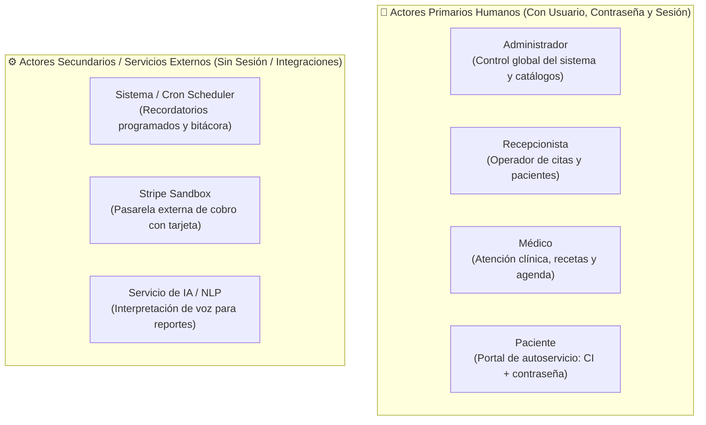
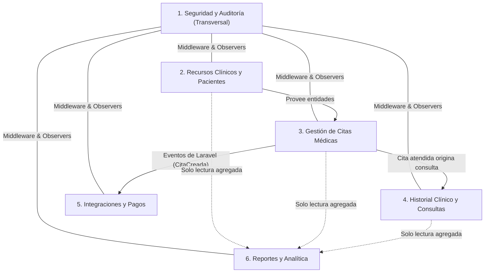

# 🏥 Arquitectura del Sistema y Especificación de Casos de Uso (PUDS / RUP)
### Clínica Vida Salud — Centro Médico La Cruz

> **Metodología:** PUDS (Proceso Unificado de Desarrollo de Software) / RUP  
> **Alcance:** Examen Parcial II — Sistemas de Información I  
> **Total de Casos de Uso Aprobados:** **23 CU** (con 1 CU condicional/reserva para el Ciclo 2)  
> **Decisión de Modelado:** Se unifica **Médico** como un **único actor**, tratando la especialidad como un atributo/relación del profesional (alineado estrictamente con el examen).  
> **Stack Oficial del Proyecto:**  
> - **Backend:** Laravel 13 (PHP 8.3) con arquitectura de servicios y transacciones  
> - **Base de Datos:** PostgreSQL con restricciones de integridad relacional  
> - **Frontend:** React + JavaScript (`.jsx` / ES6+), HTML5 y CSS (Tailwind CSS)

---

## 1. Clasificación Rigurosa de Actores

En UML y PUDS, un **Actor** representa un conjunto coherente de roles que los usuarios juegan al interactuar con el sistema. 

### 💡 Decisión Arquitectónica: ¿Médico y Especialista juntos o separados?
**Recomendación definitiva: UN SOLO ACTOR (`Médico`).**  
1. **Identidad de Interacciones en UML:** Un actor se justifica si posee interacciones o casos de uso exclusivos. En este sistema, el especialista y el médico general hacen exactamente lo mismo: atienden la consulta, llenan el triaje, registran diagnóstico, emiten recetas y consultan su agenda. No existe ningún caso de uso que sea exclusivo de un especialista (como derivaciones complejas o interconsultas hospitalarias).
2. **Alineación con el Examen:** El documento del examen oficial (§3) solo define 3 roles de personal: **Administrador, Recepcionista y Médico**. El RF03 aclara que un médico *"puede tener una o varias especialidades"*. "Medicina General" es simplemente una especialidad más del catálogo (RF04), al igual que "Pediatría" o "Cardiología".
3. **Eficiencia en BD y RBAC:** Evita duplicar roles en la base de datos (`MEDICO`), simplifica las políticas de autorización (*Policies*) y evita recargar innecesariamente el diagrama de casos de uso con líneas duplicadas.



### 1.1. Actores Primarios Humanos (Usuarios del Sistema)

| # | Actor | Rol / Permiso | Nivel de Acceso y Funciones en el Sistema |
|:---:|:---|:---|:---|
| **A1** | **Administrador** | Superusuario / Gestión | Gestiona cuentas de usuarios, roles, catálogo de médicos, especialidades con rangos de edad, franjas horarias, auditoría y reportes gerenciales. |
| **A2** | **Recepcionista** | Operativo de Atención | Registra y modifica pacientes, consulta disponibilidad, programa, reprograma y cancela citas; controla la asistencia presencial. |
| **A3** | **Médico** | Asistencial Clínico | Consulta su agenda diaria, atiende consultas (triaje, diagnóstico, recetas) y gestiona antecedentes médicos de sus pacientes. Abarca tanto médicos generales como especialistas (la especialidad es un dato asociado al médico). |
| **A4** | **Paciente** | Autoservicio / Limitado | Cuenta vinculada a su CI. Gestiona su perfil personal, reserva/reprograma/cancela **únicamente sus citas**, consulta su historial médico en **solo lectura** y realiza pagos. *(Nota: la recepcionista también puede crear un paciente sin cuenta de autoservicio).* |

### 1.2. Actores Secundarios y Servicios Externos (Integraciones)

| # | Actor | Naturaleza | Interacción con el Sistema |
|:---:|:---|:---|:---|
| **S1** | **Sistema (Planificador / Cron)** | Autónomo interno | Tareas en segundo plano que disparan recordatorios de citas y registran la bitácora pasiva ante mutaciones de datos. |
| **S2** | **Stripe (Modo Prueba)** | Pasarela externa (API) | Procesa pagos con tarjetas tokenizadas de prueba y devuelve la confirmación del cobro sin manejar dinero real. |
| **S3** | **Servicio de IA (NLP / Transcripción)** | Servicio externo (API) | Recibe el texto transcrito de la voz del usuario y extrae parámetros estructurados para ejecutar los filtros dinámicos de reportes. |

---

## 2. Análisis de Cohesión y Acoplamiento



- **Alta Cohesión:** Cada paquete se enfoca en un único objetivo de negocio claro:
  - `P1`: Seguridad y control de accesos.
  - `P2`: Catálogos maestros de la clínica (pacientes, médicos, especialidades, horarios).
  - `P3`: Ciclo de vida y transacciones de las citas médicas.
  - `P4`: Información confidencial del acto médico asistencial.
  - `P5`: Adaptadores aislados a servicios de terceros (Stripe y Push/Mail).
  - `P6`: Consultas de solo lectura y agregación analítica.
- **Bajo Acoplamiento:** Los paquetes se comunican en una sola dirección; no existen dependencias circulares y las integraciones entre citas y notificaciones ocurren mediante eventos desacoplados de Laravel.

---

## 3. Catálogo Oficial de Casos de Uso (23 Casos de Uso)

### 📦 Paquete 1: Seguridad y Auditoría

| CU | Nombre del Caso de Uso | Actor(es) | Descripción del Proceso | RF | Ciclo |
|:---:|:---|:---|:---|:---:|:---:|
| **CU01** | Autenticar usuario | Todos los usuarios | Valida credenciales contra hash criptográfico (`password_verify`). Inicia sesión segura, resuelve el menú según rol y bloquea rutas protegidas. Incluye recuperación de contraseña por correo. | RF01 | **1** |
| **CU02** | Gestionar usuarios, roles y permisos | Administrador | Alta, edición, activación y baja lógica de usuarios del sistema. Asigna roles (`Administrador`, `Recepcionista`, `Médico`, `Paciente`). | RF01 | **1** |
| **CU03** | Gestionar bitácora de auditoría | Administrador, Sistema | Consulta en solo lectura de acciones registradas automáticamente (altas, modificaciones, cancelaciones) con filtros por usuario, acción, módulo y rango de fechas. | Extra | **2** |

---

### 📦 Paquete 2: Gestión de Recursos Clínicos y Pacientes

| CU | Nombre del Caso de Uso | Actor(es) | Descripción del Proceso | RF | Ciclo |
|:---:|:---|:---|:---|:---:|:---:|
| **CU04** | Gestionar pacientes | Recepcionista, Administrador | Registra, busca (por CI, nombre, apellido), modifica datos demográficos y desactiva pacientes sin eliminar historial asociado. Valida unicidad de CI. | RF02 | **1** |
| **CU05** | Gestionar cuenta y perfil del paciente | Paciente, Recepcionista | Activa la cuenta web vinculada a la CI del paciente. Permite al paciente editar datos de contacto, contacto de emergencia y preferencias de notificación. | 3.4 | **2** |
| **CU06** | Gestionar médicos | Administrador | Registra y edita profesionales de la salud con matrícula profesional, teléfono, correo y asignación de especialidades. Médicos inactivos no reciben citas pero conservan histórico. | RF03 | **1** |
| **CU07** | Gestionar especialidades médicas | Administrador | Gestiona catálogo de especialidades con nombres normalizados únicos y define el **rango de edad** aplicable (Pediatría <15, Medicina General 15-59, Geriatría ≥60 años). | RF04 | **1** |
| **CU08** | Gestionar horarios de atención médica | Administrador | Define días, hora inicial, hora final y duración fija de cita por médico. Valida coherencia horaria (fin posterior a inicio) y permite bloquear feriados. | RF05 | **1** |

---

### 📦 Paquete 3: Gestión de Citas Médicas

| CU | Nombre del Caso de Uso | Actor(es) | Descripción del Proceso | RF | Ciclo |
|:---:|:---|:---|:---|:---:|:---:|
| **CU09** | Consultar disponibilidad de horarios | Recepcionista, Paciente | Calcula e ilustra los horarios libres para un médico y fecha dada, descartando cupos reservados, horarios pasados, feriados y médicos inactivos. | RF05, RF06 | **1** |
| **CU10** | Programar cita médica | Recepcionista, Paciente | Selecciona paciente, especialidad, médico, fecha y hora. Sugiere especialidad según edad. Genera código correlativo único (ej. `CM-0001`) y valida disponibilidad dentro de una transacción (`DB::transaction`) para evitar solapamientos. | RF06, RF07 | **1** |
| **CU11** | Reprogramar cita médica | Recepcionista, Paciente | Modifica fecha y hora de una cita en estado *Programada* o *Confirmada*, verificando disponibilidad. No permite reprogramar citas *Atendidas* o *Canceladas*. | RF08 | **1** |
| **CU12** | Cancelar cita médica | Recepcionista, Paciente | Cambia el estado a *Cancelada* con registro obligatorio del motivo. Libera de inmediato el cupo horario sin borrar el registro físico. | RF09 | **1** |
| **CU13** | Registrar asistencia y estado de cita | Recepcionista, Médico | Aplica transiciones válidas: *Programada* → *Confirmada* → *Atendida* / *Inasistencia*. Bloquea transiciones ilegales según la máquina de estados. | RF10 | **1** |
| **CU14** | Consultar agenda médica diaria | Médico, Recepcionista, Admin | Despliega el listado de citas de un médico por fecha y estado, detallando hora, paciente, especialidad, código y estado. | RF11 | **1** |
| **CU15** | Consultar historial de citas de paciente | Recepcionista, Paciente, Médico | Muestra la cronología de citas previas, atendidas y canceladas del paciente con fecha, médico y resultado de la atención. | RF12 | **1** |

---

### 📦 Paquete 4: Historial Clínico y Consultas

| CU | Nombre del Caso de Uso | Actor(es) | Descripción del Proceso | RF | Ciclo |
|:---:|:---|:---|:---|:---:|:---:|
| **CU16** | Registrar consulta médica | Médico | Registra motivo, signos vitales/triaje, diagnóstico y conducta terapéutica. Al completar, pasa la cita vinculada automáticamente a estado *Atendida*. | Extra | **2** |
| **CU17** | Gestionar antecedentes médicos | Médico | Registra y clasifica antecedentes clínicos (patológicos, quirúrgicos, alérgicos, familiares, farmacológicos) integrados a la ficha permanente. | Extra | **2** |
| **CU18** | Gestionar expediente clínico digital | Médico | Módulo asistencial de escritura: emisión de recetas estructuradas, notas de evolución y archivo clínico. Exclusivo para médicos. | Extra | **2** |
| **CU19** | Consultar expediente médico y antecedentes | Paciente, Médico | Consulta protegida: el médico consulta el expediente completo del paciente en consulta; el paciente consulta **únicamente su propio expediente en solo lectura**. | 3.4 | **2** |

---

### 📦 Paquete 5: Integraciones Externas y Pagos

| CU | Nombre del Caso de Uso | Actor(es) | Descripción del Proceso | RF | Ciclo |
|:---:|:---|:---|:---|:---:|:---:|
| **CU20** | Enviar recordatorios y notificaciones | Sistema (Planificador) | Servicio background que dispara notificaciones push/email de confirmación, proximidad de cita, reprogramación o cancelación. | 3.4 | **2** |
| **CU21** | Pagar cita médica con Stripe | Paciente, Recepcionista, Stripe | Procesa cobros de citas con tarjeta de crédito en modo prueba (sandbox de Stripe). Registra la transacción y marca la cita como garantizada. | Extra | **2** |

---

### 📦 Paquete 6: Reportes y Analítica

| CU | Nombre del Caso de Uso | Actor(es) | Descripción del Proceso | RF | Ciclo |
|:---:|:---|:---|:---|:---:|:---:|
| **CU22** | Generar reportes con filtros dinámicos | Administrador, Recepcionista, Médico | Genera los 7 reportes del RF13 (citas por fecha, médico, especialidad, estado, pacientes activos, balance atendidas/canceladas y agenda diaria) con exportación a CSV/PDF. | RF13 | **2** |
| **CU23** | Generar reporte personalizado por voz con IA | Administrador, Servicio de IA | El usuario dicta el reporte por el micrófono del navegador; el servicio de IA interpreta los criterios de consulta y genera los filtros automáticamente. | Extra | **2** |

---

## 4. Caso de Uso en Reserva / Condicional (Para evaluar en Ciclo 2)

> **Estado:** 🟡 *En Reserva para el Ciclo 2*  
> **Motivo:** En sistemas clínicos reales, la responsabilidad de diagnóstico recae exclusivamente sobre el médico humano. No obstante, se mantiene formalizado como módulo opcional de asistencia secundaria si el equipo y el docente deciden incluirlo en la segunda entrega.

| CU | Nombre del Caso de Uso | Actor(es) | Descripción del Proceso | Paquete | Impacto / Dependencia |
|:---:|:---|:---|:---|:---:|:---|
| **CU24-OPC** *(Ex-CU20)* | Generar análisis clínico y diagnóstico asistido por IA | Médico, Servicio de IA | A solicitud explícita del médico durante la consulta (CU16), el sistema envía los signos vitales, motivo y antecedentes a un LLM clínico para sugerir diagnósticos diferenciales o alertar posibles interacciones medicamentosas. **Es una herramienta de apoyo, no sustituye el dictamen médico.** | P4 (Historial Clínico) | Extiende de CU16 / CU19. Requiere integración API adicional con OpenAI/Gemini/Claude y advertencia explícita de deslinde de responsabilidad legal. |

---

## 5. División de Casos de Uso en 2 Ciclos PUDS

| Ciclo de Desarrollo | Casos de Uso Asignados | Hito / Entrega | Justificación PUDS |
|:---|:---|:---|:---|
| **Ciclo 1: Cita de Punta a Punta** *(13 Casos de Uso)* | **CU01, CU02, CU04, CU06, CU07, CU08, CU09, CU10, CU11, CU12, CU13, CU14, CU15** | **Presentación 1** (Domingo 25/10/2026 — Avance ≥ 50%) | Cubre los requerimientos nucleares obligatorios (**RF01 a RF12**) y resuelve de manera verificable las **10 pruebas mínimas exigidas por el examen**. |
| **Ciclo 2: Clínico, Integraciones y Analítica** *(10 Casos de Uso + 1 Opcional)* | **CU03, CU05, CU16, CU17, CU18, CU19, CU20, CU21, CU22, CU23** *(Opcional: CU24-OPC)* | **Presentación 2** (Domingo 08/11/2026 — 100% Funcional) | Incorpora la bitácora visible, el perfil del paciente (§3.4), expediente clínico completo, recetas, pagos con Stripe, recordatorios, reportes dinámicos/voz (RF13) y evaluación del asistente diagnóstico. |

---

## 6. Arquitectura del Frontend: React + JavaScript (`.jsx`)

Siguiendo las pautas del examen (HTML, CSS y JavaScript interactivo con React), la estructura de la aplicación frontend se organiza por dominios funcionales en JavaScript estándar:

```text
frontend/src/
├── assets/                  # Logos, tipografías e imágenes clínicas
├── components/              # Componentes UI reutilizables (Botones, Modales, Inputs, Navbar, Sidebar)
│   ├── ui/
│   └── Layout.jsx
├── apps/                    # Módulos desacoplados organizados por dominio funcional
│   ├── auth/                # Vistas y lógica de Login y recuperación (CU01, CU02)
│   │   ├── LoginPage.jsx
│   │   └── useAuth.js
│   ├── clinical-resources/  # Gestión de Pacientes, Médicos, Horarios (CU04, CU06, CU07, CU08)
│   │   ├── PatientsManager.jsx
│   │   ├── DoctorsManager.jsx
│   │   └── SchedulesManager.jsx
│   ├── appointments/        # Calendario, disponibilidad y reserva (CU09, CU10, CU11, CU12, CU13, CU14, CU15)
│   │   ├── AppointmentBookingModal.jsx
│   │   ├── DoctorAgendaView.jsx
│   │   └── AppointmentHistory.jsx
│   ├── medical-records/     # Expediente digital, consulta y triaje (CU16, CU17, CU18, CU19, [CU24-OPC])
│   │   ├── ConsultationForm.jsx
│   │   └── PatientRecordView.jsx
│   ├── payments/            # Formulario de pago con Stripe Elements (CU21)
│   │   └── StripePaymentModal.jsx
│   └── analytics/           # Tablas dinámicas, exportador y micrófono IA (CU22, CU23)
│       ├── DynamicReportsView.jsx
│       └── VoiceReportAssistant.jsx
├── services/                # Clientes API HTTP (fetch / axios) hacia Laravel
│   └── api.js
├── App.jsx                  # Router principal y gestor de contexto de sesión
├── index.css                # Configuración de estilos Tailwind CSS
└── main.jsx                 # Punto de entrada de la aplicación
```
