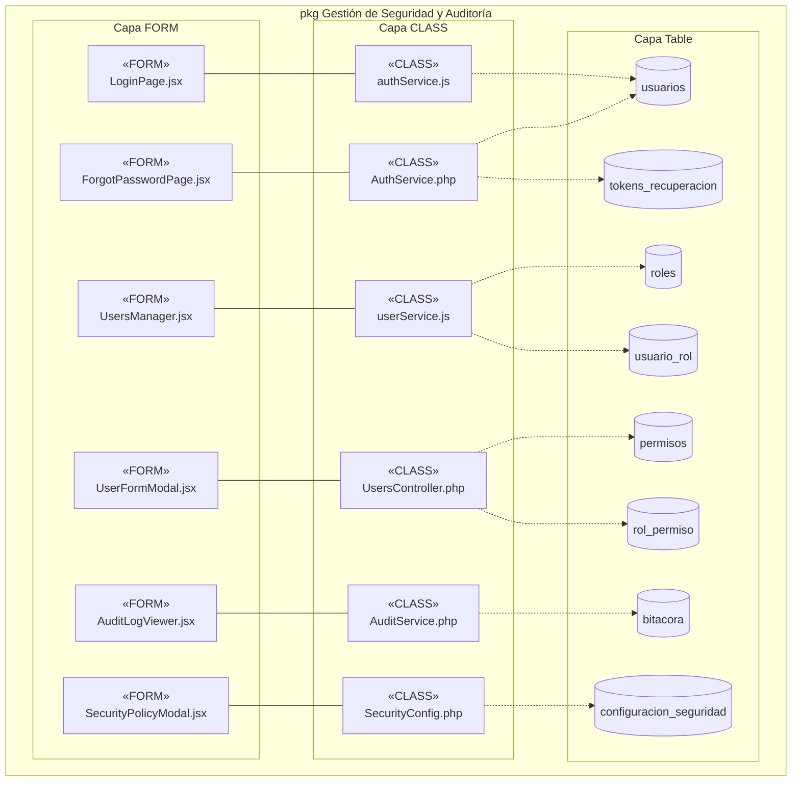
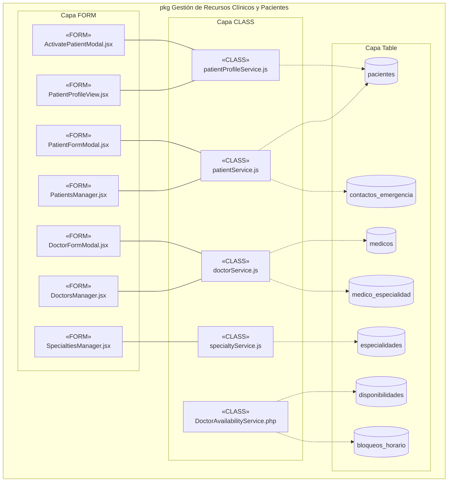
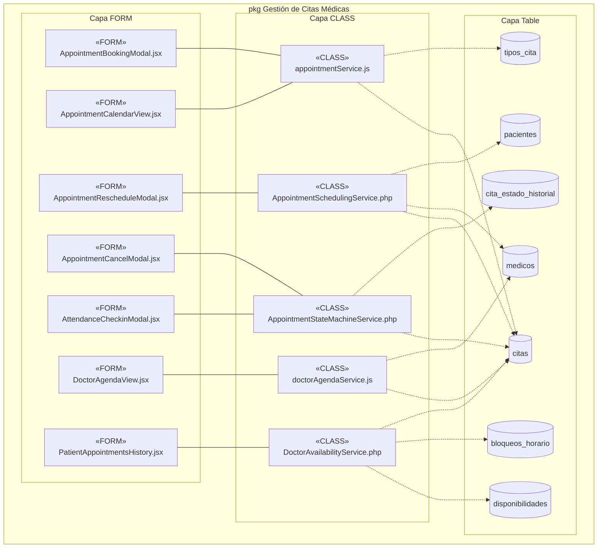

# Diagramas de Arquitectura de Implementación (Componentes y Subsistemas)
**Proyecto:** Clínica Vida Salud (Centro Médico La Cruz)  
**Metodología:** PUDS / RUP (Fase de Construcción / Vista de Implementación)  
**Estándar:** UML 2.5+ (Diagramas de Componentes)  
**Estado:** P1 y P2 Implementados, P3 Diseñado para Ejecución Inmediata

---

## 1. 📁 Archivos Draw.io Oficiales y Espejos

| Diagrama | Ubicación Oficial (`docs/UML/`) | Ubicación Documental (`documentationDocs/`) |
|---|---|---|
| **Arquitectura General del Sistema** | [**`docs/UML/Arquitectura_General_Componentes.drawio`**](file:///c:/Users/PERSONAL/clinica-SI1/docs/UML/Arquitectura_General_Componentes.drawio) | [**`documentationDocs/.../Arquitectura_General_Clinica_Componentes.drawio`**](file:///c:/Users/PERSONAL/clinica-SI1/documentationDocs/4DiagramsImplementacion/Arquitectura_General_Clinica_Componentes.drawio) |
| **Subsistema P1: Seguridad y Auditoría** | [**`docs/UML/P1_Seguridad_Auditoria_Componentes.drawio`**](file:///c:/Users/PERSONAL/clinica-SI1/docs/UML/P1_Seguridad_Auditoria_Componentes.drawio) | [**`documentationDocs/.../P1_Seguridad_Auditoria_Clinica_Componentes.drawio`**](file:///c:/Users/PERSONAL/clinica-SI1/documentationDocs/4DiagramsImplementacion/P1_Seguridad_Auditoria_Clinica_Componentes.drawio) |
| **Subsistema P2: Recursos Clínicos y Pacientes** | [**`docs/UML/P2_Recursos_Clinicos_Pacientes_Componentes.drawio`**](file:///c:/Users/PERSONAL/clinica-SI1/docs/UML/P2_Recursos_Clinicos_Pacientes_Componentes.drawio) | [**`documentationDocs/.../P2_Recursos_Clinicos_Clinica_Componentes.drawio`**](file:///c:/Users/PERSONAL/clinica-SI1/documentationDocs/4DiagramsImplementacion/P2_Recursos_Clinicos_Clinica_Componentes.drawio) |
| **Subsistema P3: Gestión de Citas Médicas** | [**`docs/UML/P3_Gestion_Citas_Componentes.drawio`**](file:///c:/Users/PERSONAL/clinica-SI1/docs/UML/P3_Gestion_Citas_Componentes.drawio) | [**`documentationDocs/.../P3_Gestion_Citas_Clinica_Componentes.drawio`**](file:///c:/Users/PERSONAL/clinica-SI1/documentationDocs/4DiagramsImplementacion/P3_Gestion_Citas_Clinica_Componentes.drawio) |

---

## 2. 🏛️ Estilo Visual y Formato Limpio de Componentes

Siguiendo el estándar acordado (sin descripciones verbales ni números de CU dentro de las cajas):
- **Capa Superior (`«FORM»`):** Relleno rosa (`#f8cecc`), borde `#b85450`, icono UML de componente en esquina superior derecha. Contenido: Estereotipo `<<FORM>>`, línea divisoria y nombre del archivo `.jsx`.
- **Conectores Intermedios:** Interfaces UML *ball-and-socket* (`halfCircle` para dependencias requeridas del formulario, `circle` para interfaces provistas por la clase/servicio).
- **Capa Intermedia (`«CLASS»`):** Relleno naranja (`#fad7ac`), borde `#b46504`, icono UML de componente. Contenido: Estereotipo `<<CLASS>>`, línea divisoria y nombre del servicio (`.js` o `.php`).
- **Capa Inferior (`«Table»`):** Relleno azul (`#dae8fc`), borde `#6c8ebf`, icono UML de componente. Conexiones discontinuas con flecha abierta `«use»` desde las clases.

---

## 3. 🛡️ Subsistema P1: Gestión de Seguridad y Auditoría

### Previa Mermaid

---

## 4. 🩺 Subsistema P2: Recursos Clínicos y Pacientes

### Previa Mermaid

---

## 5. 📅 Subsistema P3: Gestión de Citas Médicas

Diseñado conforme a la especificación oficial de Casos de Uso (`CU09` a `CU15`) y al esquema DDL de PostgreSQL:

### Previa Mermaid

### Relación de Tablas y Reglas de Negocio en P3
1. **`citas`:** Entidad central con restricción anti-colisión `uq_cita_medico_hora_activa` para estados `PROGRAMADA` y `CONFIRMADA`.
2. **`cita_estado_historial`:** Auditoría de transición de estados (`PROGRAMADA` → `CONFIRMADA` → `ATENDIDA` / `INASISTENCIA` / `CANCELADA`).
3. **`tipos_cita`:** Catálogo de consulta (Primera consulta, Control, Reconsulta).
4. **`disponibilidades` y `bloqueos_horario`:** Detección de rangos laborales y licencias/feriados.
5. **`medicos` y `pacientes`:** Relación foránea directa con validación de edad y correlativo único (`CM-XXXX`).
