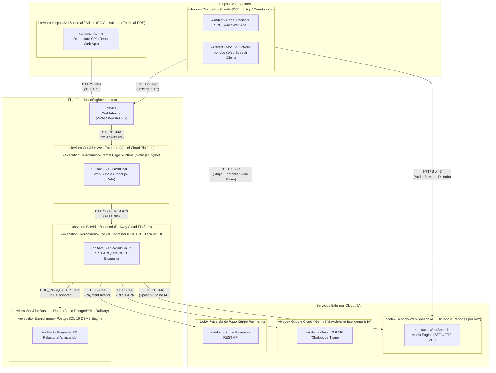

# Diagrama de Despliegue — Clínica Vida Salud (Centro Médico La Cruz)
**Metodología:** PUDS / RUP (Fase de Construcción / Diseño Físico)  
**Estándar:** UML 2.5+  
**Script de Automatización para Enterprise Architect:** [`docs/UML/diagrama_despliegue.js`](file:///c:/Users/PERSONAL/clinica-SI1/docs/UML/diagrama_despliegue.js)

---

## 1. 📐 Distribución Espacial del Diagrama (Patrón 3 Columnas)

El diagrama sigue estrictamente la distribución visual y semántica del diseño de referencia de Enterprise Architect:

```
┌─────────────────────────────────┐   ┌─────────────────────────────────┐   ┌─────────────────────────────────┐
│        COLUMNA IZQUIERDA        │   │         COLUMNA CENTRAL         │   │         COLUMNA DERECHA         │
│     (Infraestructura Cloud)     │   │     (Servicios Externos / IA)   │   │       (Dispositivos Cliente)    │
├─────────────────────────────────┤   ├─────────────────────────────────┤   ├─────────────────────────────────┤
│ «device» Red Internet           │   │                                 │   │ «device» Dispositivo Admin      │
│ (WAN / Red Pública)             │◄──┼─────────────────────────────────┼───┤ (PC Consultorio / Terminal)     │
│       │                         │   │                                 │   └─────────────────────────────────┘
│       │ HTTPS :443 (CDN/HTTP2)  │   │                                 │
│       ▼                         │   │                                 │   ┌─────────────────────────────────┐
│ «device» Servidor Web Frontend  │   │ «Node» Servicio Web Speech API  │◄──┤ «device» Dispositivo Cliente    │
│ (Vercel Cloud Platform)         │   │ (Dictado & Reportes por Voz)    │   │ (PC / Smartphone - Paciente)    │
│       │                         │   └─────────────────────────────────┘   └─────────────────┬───────────────┘
│       │ HTTPS/REST JSON         │                                                           │
│       ▼                         │   ┌─────────────────────────────────┐                     │
│ «device» Servidor Backend       ├──►│ «Node» Google Cloud - Gemini AI │                     │
│ (Railway - PHP 8.3 / Laravel)   │   │ (Gemini 3.6 - Asistente & Chat) │                     │
│       │                         │   └─────────────────────────────────┘                     │
│       │ PDO_PGSQL :5432 [SSL]   │                                                           │
│       ▼                         │   ┌─────────────────────────────────┐                     │
│ «device» Servidor Base de Datos ├──►│ «Node» Pasarela de Pago         │◄────────────────────┘
│ (Cloud PostgreSQL - Railway)    │   │ (Stripe Payments REST API)      │  HTTPS (Stripe Elements)
└─────────────────────────────────┘   └─────────────────────────────────┘
```

---

## 2. 🗺️ Diagrama Mermaid (Vista de Referencia)



---

## 3. 🎨 Especificación de Componentes y Estilos Visuales (EA)

| Elemento | Tipo UML | Color en Enterprise Architect | Especificación y Rol |
|---|---|---|---|
| **Dispositivo Sucursal / Admin** | `«device»` | Azul claro (`#DAEEFF`) | Terminal de escritorio en consultorio/recepción con SPA de gestión clínica. |
| **Dispositivo Cliente** | `«device»` | Azul claro (`#DAEEFF`) | Dispositivo del paciente (móvil/PC) para citas, pagos y chat de triaje. |
| **Red Internet** | `«device»` | Azul claro (`#DAEEFF`) | Red WAN pública con cifrado TLS 1.3, HTTPS y WebSockets. |
| **Servidor Web Frontend** | `«device»` | Azul claro (`#DAEEFF`) | Alojamiento en Vercel con distribución global Edge CDN del bundle React. |
| **Servidor Backend** | `«device»` | Azul claro (`#DAEEFF`) | Contenedor Railway con PHP 8.3 + Laravel 13 para REST API transaccional. |
| **Servidor Base de Datos** | `«device»` | Azul claro (`#DAEEFF`) | Servicio gestionado en Railway para base de datos relacional PostgreSQL. |
| **PostgreSQL 16 DBMS Engine** | `«executionEnvironment»` | Rosa / Coral (`#FFCCCC`) | Motor PostgreSQL 16 con ACID, aislamiento de transacciones y backups. |
| **Esquema BD Relacional** | `«artifact»` | Rosa / Coral (`#FFCCCC`) | Estructura de tablas del sistema (`clinica_db`) en PostgreSQL. |
| **Web Speech API** | `«Node»` | Amarillo pastel (`#FFFFCC`) | Servicio W3C SpeechRecognition / SpeechSynthesis para dictado y reportes. |
| **Google Cloud Gemini AI** | `«Node»` | Amarillo pastel (`#FFFFCC`) | API Gemini 3.6 para chatbot de triaje médico y asistencia clínica. |
| **Pasarela de Pago Stripe** | `«Node»` | Amarillo pastel (`#FFFFCC`) | Plataforma de pagos segura PCI-DSS (Stripe Elements + Webhooks). |

---

## 4. 🔗 Relaciones y Protocolos de Comunicación

1. **`Dispositivo Sucursal / Admin ──► Red Internet`:** `HTTPS :443 (TLS 1.3)`
2. **`Dispositivo Cliente ──► Red Internet`:** `HTTPS :443 (WSS/TLS 1.3)`
3. **`Red Internet ──► Servidor Web Frontend`:** `HTTPS :443 (CDN / HTTP/2)`
4. **`Servidor Web Frontend ──► Servidor Backend`:** `HTTPS / REST JSON (API Calls)`
5. **`Servidor Backend ──► Servidor Base de Datos`:** `PDO_PGSQL / TCP :5432 [SSL Encrypted]`
6. **`Dispositivo Cliente ──► Servicio Web Speech API`:** `HTTPS :443 (Audio Stream / Dictado)`
7. **`Servidor Backend ──► Servicio Web Speech API`:** `HTTPS :443 (Speech Engine API)`
8. **`Servidor Backend ──► Google Cloud - Gemini AI`:** `HTTPS :443 (REST API)`
9. **`Servidor Backend ──► Pasarela de Pago Stripe`:** `HTTPS :443 (Payment Intents)`
10. **`Dispositivo Cliente ──► Pasarela de Pago Stripe`:** `HTTPS :443 (Stripe Elements / Card Token)`

---

## 5. 🚀 Ejecución en Enterprise Architect

1. Abre tu proyecto en **Enterprise Architect** (`.eap`, `.eapx` o `.qea`).
2. Presiona `Ctrl + Alt + S` o ve a **Specialize** > **Tools** > **Scripting**.
3. Abre o crea un script de tipo **JScript** y pega el contenido de [**`docs/UML/diagrama_despliegue.js`**](file:///c:/Users/PERSONAL/clinica-SI1/docs/UML/diagrama_despliegue.js).
4. Presiona **Run** (`F5`). El script generará y abrirá automáticamente el diagrama con el layout exacto de 3 columnas y la paleta de colores requerida.
