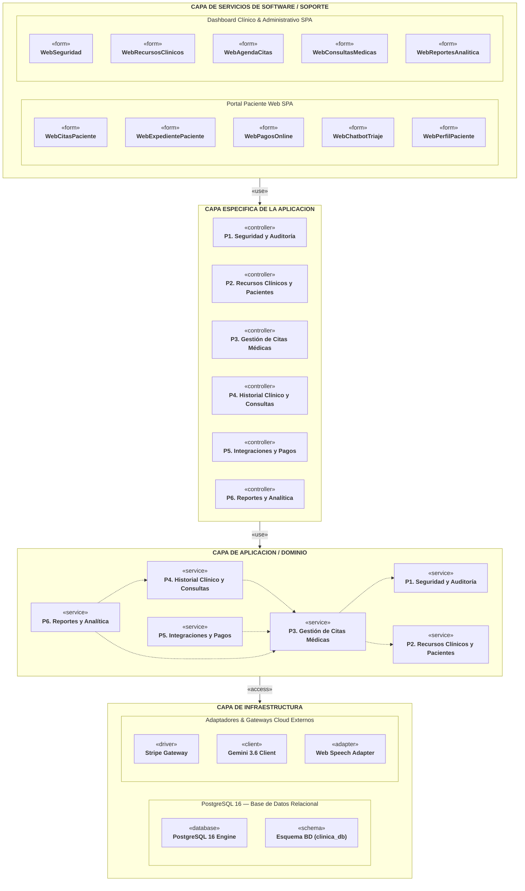

# Diagrama de Paquetes — Diseño Lógico de Arquitectura (4 Capas PUDS / RUP)
**Proyecto:** Clínica Vida Salud (Centro Médico La Cruz)  
**Metodología:** PUDS / RUP (Fase de Elaboración y Construcción / Vista Lógica)  
**Estándar:** UML 2.5+ (Diagrama de Paquetes — Formato Minimalista y Limpio)  
**Archivos Draw.io:** 
- [**`docs/UML/diagrama_paquetes.drawio`**](file:///c:/Users/PERSONAL/clinica-SI1/docs/UML/diagrama_paquetes.drawio)
- [**`documentationDocs/3DiagramasDiseño/Diagrama_Logico_ClinicaVidaSalud.drawio.xml`**](file:///c:/Users/PERSONAL/clinica-SI1/documentationDocs/3DiagramasDiseño/Diagrama_Logico_ClinicaVidaSalud.drawio.xml)

---

## 1. 🏛️ Estructura Limpia de las 4 Capas Arquitectónicas

Se eliminaron los textos extensos, listas de controladores y códigos de casos de uso para mantener exclusivamente los nombres de las capas, los nombres de los componentes y sus estereotipos UML (`«form»`, `«controller»`, `«service»`, `«database»`, `«driver»`) separados por línea:

```
┌────────────────────────────────────────────────────────┐
│        CAPA DE SERVICIOS DE SOFTWARE / SOPORTE         │
└───────────────────────────┬────────────────────────────┘
                            │ «use»
                            ▼
┌────────────────────────────────────────────────────────┐
│           CAPA ESPECIFICA DE LA APLICACION             │
└───────────────────────────┬────────────────────────────┘
                            │ «use»
                            ▼
┌────────────────────────────────────────────────────────┐
│             CAPA DE APLICACION / DOMINIO               │
└───────────────────────────┬────────────────────────────┘
                            │ «access»
                            ▼
┌────────────────────────────────────────────────────────┐
│                CAPA DE INFRAESTRUCTURA                 │
└────────────────────────────────────────────────────────┘
```

---

## 2. 🗺️ Previa del Diagrama Lógico en Mermaid



---

## 3. 📦 Matriz de Elementos por Capa

| Capa | Sub-contenedor | Componentes Modelados | Estereotipo |
|---|---|---|:---:|
| **Capa de Servicios de Software / Soporte** | Portal Paciente Web SPA | `WebCitasPaciente`, `WebExpedientePaciente`, `WebPagosOnline`, `WebChatbotTriaje`, `WebPerfilPaciente` | `«form»` |
| **Capa de Servicios de Software / Soporte** | Dashboard Clínico & Admin SPA | `WebSeguridad`, `WebRecursosClinicos`, `WebAgendaCitas`, `WebConsultasMedicas`, `WebReportesAnalitica` | `«form»` |
| **Capa Específica de la Aplicación** | Paquetes P1 a P6 | `P1. Seguridad y Auditoría`<br>`P2. Recursos Clínicos y Pacientes`<br>`P3. Gestión de Citas Médicas`<br>`P4. Historial Clínico y Consultas`<br>`P5. Integraciones y Pagos`<br>`P6. Reportes y Analítica` | `«controller»` |
| **Capa de Aplicación / Dominio** | Paquetes P1 a P6 | `P1. Seguridad y Auditoría`<br>`P2. Recursos Clínicos y Pacientes`<br>`P3. Gestión de Citas Médicas`<br>`P4. Historial Clínico y Consultas`<br>`P5. Integraciones y Pagos`<br>`P6. Reportes y Analítica` | `«service»` |
| **Capa de Infraestructura** | PostgreSQL 16 | `PostgreSQL 16 Engine`<br>`Esquema BD (clinica_db)` | `«database»`<br>`«schema»` |
| **Capa de Infraestructura** | Gateways Cloud | `Stripe Gateway`<br>`Gemini 3.6 Client`<br>`Web Speech Adapter` | `«driver»`<br>`«client»`<br>`«adapter»` |

---

## 4. 🎨 Cómo Abrir en Draw.io
1. Abre **[draw.io](https://app.diagrams.net/)**.
2. Ve a **Archivo** > **Abrir desde** > **Dispositivo...** y carga [**`docs/UML/diagrama_paquetes.drawio`**](file:///c:/Users/PERSONAL/clinica-SI1/docs/UML/diagrama_paquetes.drawio).
3. Verás la vista depurada, con el texto centrado en cada carpeta, sin saturación de texto ni referencias a casos de uso, idéntico al estilo de tu imagen.
