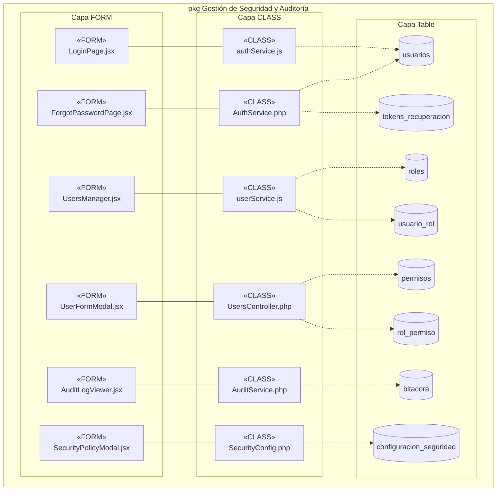
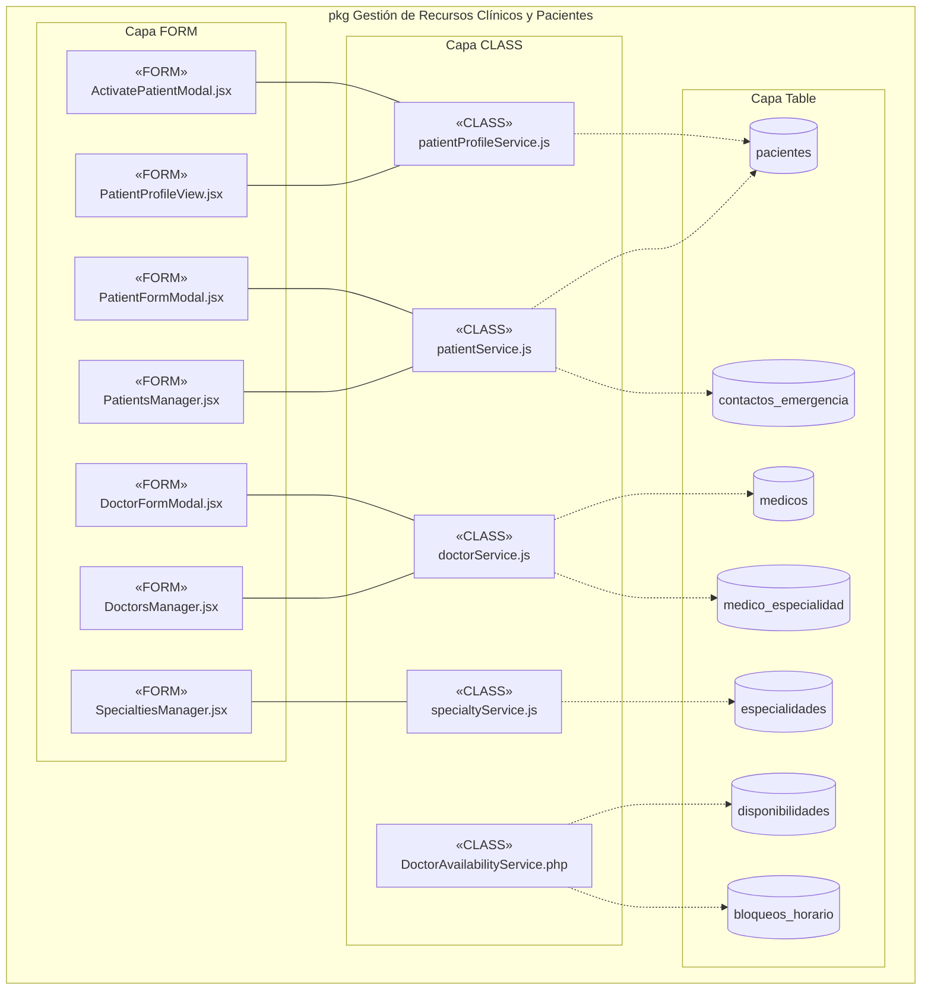
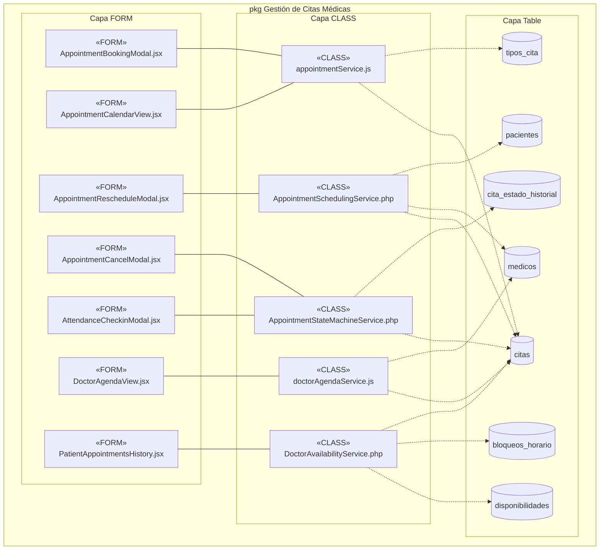
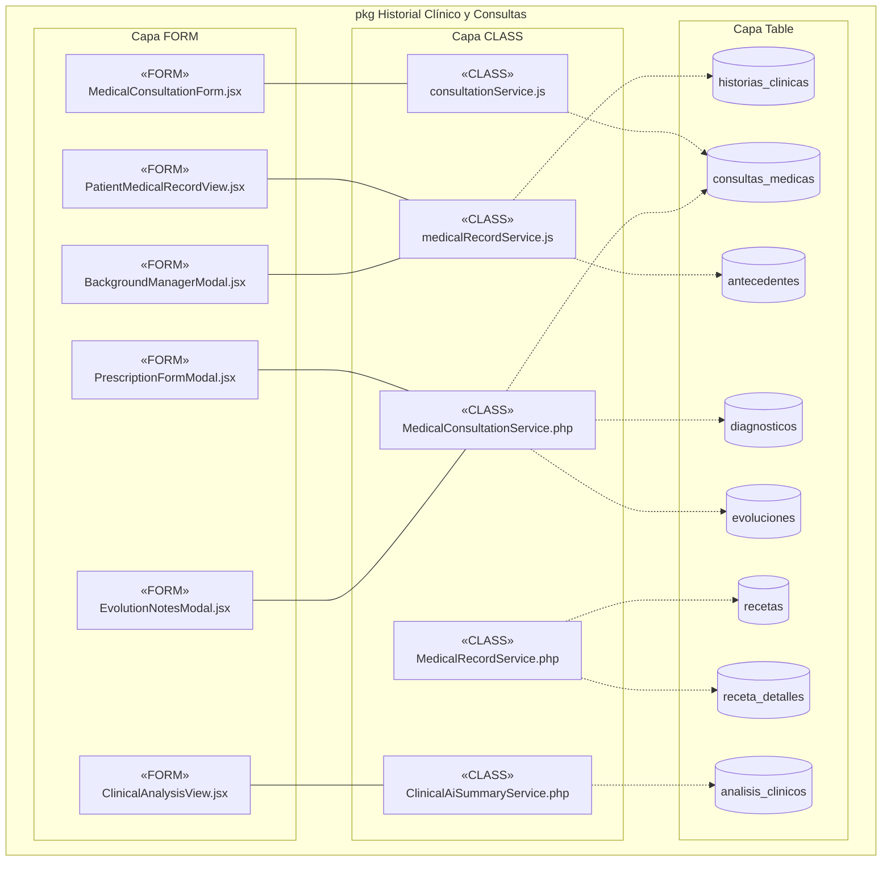
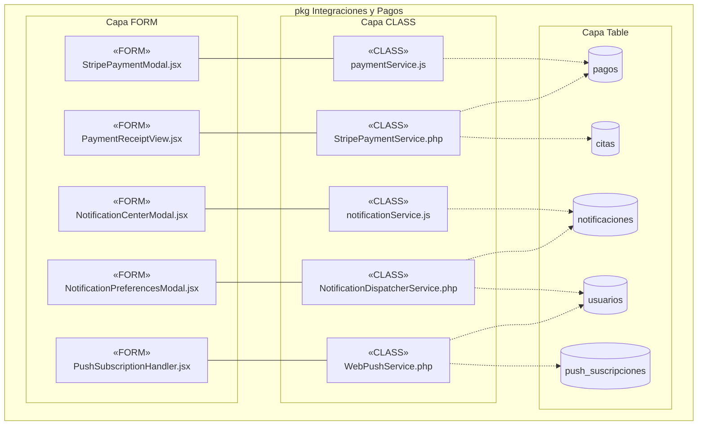
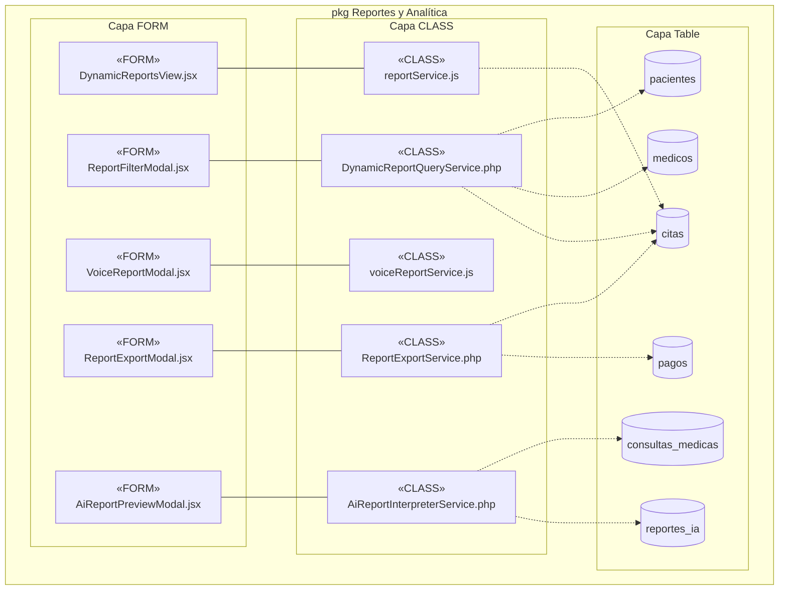

# Diagramas de Arquitectura de Implementación (Componentes y Subsistemas)
**Proyecto:** Clínica Vida Salud (Centro Médico La Cruz)  
**Metodología:** PUDS / RUP (Fase de Construcción / Vista de Implementación)  
**Estándar:** UML 2.5+ (Diagramas de Componentes)  
**Estado:** P1 y P2 Implementados; P3, P4, P5 y P6 Modelados como Previa de Arquitectura de Implementación

---

## 1. 📁 Archivos Draw.io Oficiales y Espejos

| Diagrama | Ubicación Oficial (`docs/UML/`) | Ubicación Documental (`documentationDocs/`) |
|---|---|---|
| **Arquitectura General del Sistema** | [**`docs/UML/Arquitectura_General_Componentes.drawio`**](file:///c:/Users/PERSONAL/clinica-SI1/docs/UML/Arquitectura_General_Componentes.drawio) | [**`documentationDocs/.../Arquitectura_General_Clinica_Componentes.drawio`**](file:///c:/Users/PERSONAL/clinica-SI1/documentationDocs/4DiagramsImplementacion/Arquitectura_General_Clinica_Componentes.drawio) |
| **Subsistema P1: Seguridad y Auditoría** | [**`docs/UML/P1_Seguridad_Auditoria_Componentes.drawio`**](file:///c:/Users/PERSONAL/clinica-SI1/docs/UML/P1_Seguridad_Auditoria_Componentes.drawio) | [**`documentationDocs/.../P1_Seguridad_Auditoria_Clinica_Componentes.drawio`**](file:///c:/Users/PERSONAL/clinica-SI1/documentationDocs/4DiagramsImplementacion/P1_Seguridad_Auditoria_Clinica_Componentes.drawio) |
| **Subsistema P2: Recursos Clínicos y Pacientes** | [**`docs/UML/P2_Recursos_Clinicos_Pacientes_Componentes.drawio`**](file:///c:/Users/PERSONAL/clinica-SI1/docs/UML/P2_Recursos_Clinicos_Pacientes_Componentes.drawio) | [**`documentationDocs/.../P2_Recursos_Clinicos_Clinica_Componentes.drawio`**](file:///c:/Users/PERSONAL/clinica-SI1/documentationDocs/4DiagramsImplementacion/P2_Recursos_Clinicos_Clinica_Componentes.drawio) |
| **Subsistema P3: Gestión de Citas Médicas** | [**`docs/UML/P3_Gestion_Citas_Componentes.drawio`**](file:///c:/Users/PERSONAL/clinica-SI1/docs/UML/P3_Gestion_Citas_Componentes.drawio) | [**`documentationDocs/.../P3_Gestion_Citas_Clinica_Componentes.drawio`**](file:///c:/Users/PERSONAL/clinica-SI1/documentationDocs/4DiagramsImplementacion/P3_Gestion_Citas_Clinica_Componentes.drawio) |
| **Subsistema P4: Historial Clínico y Consultas** | [**`docs/UML/P4_Historial_Clinico_Consultas_Componentes.drawio`**](file:///c:/Users/PERSONAL/clinica-SI1/docs/UML/P4_Historial_Clinico_Consultas_Componentes.drawio) | [**`documentationDocs/.../P4_Historial_Clinico_Clinica_Componentes.drawio`**](file:///c:/Users/PERSONAL/clinica-SI1/documentationDocs/4DiagramsImplementacion/P4_Historial_Clinico_Clinica_Componentes.drawio) |
| **Subsistema P5: Integraciones y Pagos** | [**`docs/UML/P5_Integraciones_Pagos_Componentes.drawio`**](file:///c:/Users/PERSONAL/clinica-SI1/docs/UML/P5_Integraciones_Pagos_Componentes.drawio) | [**`documentationDocs/.../P5_Integraciones_Pagos_Clinica_Componentes.drawio`**](file:///c:/Users/PERSONAL/clinica-SI1/documentationDocs/4DiagramsImplementacion/P5_Integraciones_Pagos_Clinica_Componentes.drawio) |
| **Subsistema P6: Reportes y Analítica** | [**`docs/UML/P6_Reportes_Analitica_Componentes.drawio`**](file:///c:/Users/PERSONAL/clinica-SI1/docs/UML/P6_Reportes_Analitica_Componentes.drawio) | [**`documentationDocs/.../P6_Reportes_Analitica_Clinica_Componentes.drawio`**](file:///c:/Users/PERSONAL/clinica-SI1/documentationDocs/4DiagramsImplementacion/P6_Reportes_Analitica_Clinica_Componentes.drawio) |

---

## 2. 🏛️ Estándar Visual y Formato Limpio de Componentes

Siguiendo el estándar UML estricto (sin descripciones verbales ni números de CU dentro de los bloques):
- **Capa Superior (`«FORM»`):** Relleno rosa (`#f8cecc`), borde `#b85450`, icono UML de componente en esquina superior derecha. Contenido: Estereotipo `<<FORM>>`, línea divisoria y nombre del archivo `.jsx`.
- **Conectores Intermedios:** Interfaces UML *ball-and-socket* (`halfCircle` para dependencias requeridas del formulario, `circle` para interfaces provistas por la clase/servicio).
- **Capa Intermedia (`«CLASS»`):** Relleno naranja (`#fad7ac`), borde `#b46504`, icono UML de componente. Contenido: Estereotipo `<<CLASS>>`, línea divisoria y nombre del servicio (`.js` o `.php`).
- **Capa Inferior (`«Table»`):** Relleno azul (`#dae8fc`), borde `#6c8ebf`, icono UML de componente. Conexiones discontinuas con flecha abierta `«use»` desde las clases.

---

## 3. 🛡️ Subsistema P1: Gestión de Seguridad y Auditoría

### Previa Mermaid

---

## 4. 🩺 Subsistema P2: Recursos Clínicos y Pacientes

### Previa Mermaid

---

## 5. 📅 Subsistema P3: Gestión de Citas Médicas

### Previa Mermaid

---

## 6. 📝 Subsistema P4: Historial Clínico y Consultas

Diseñado según los Casos de Uso `CU16`–`CU19` y las tablas clínicas del DDL:

### Previa Mermaid

---

## 7. 💳 Subsistema P5: Integraciones y Pagos

Diseñado según los Casos de Uso `CU20` (Notificaciones Push/Email) y `CU21` (Pagos con Stripe):

### Previa Mermaid

---

## 8. 📊 Subsistema P6: Reportes y Analítica

Diseñado según los Casos de Uso `CU22` (7 Reportes del RF13 con filtros y exportación PDF/CSV) y `CU23` (Reporte por voz con IA):

### Previa Mermaid

---

## 9. 🚀 Cómo Abrir los Diagramas en Draw.io
1. Entra a **[draw.io](https://app.diagrams.net/)** o abre la aplicación local Draw.io Desktop.
2. Ve a **Archivo** > **Abrir desde** > **Dispositivo...**
3. Selecciona cualquiera de los archivos `.drawio` ubicados en `docs/UML/` o en `documentationDocs/4DiagramsImplementacion/`.
4. El diseño respeta fielmente la distribución de capas visuales:
   - **Capa Superior:** Formularios `«FORM»` en rosa (`#f8cecc`).
   - **Conexiones intermedias:** Ball-and-socket UML (`circle` provides / `halfCircle` requires).
   - **Capa Intermedia:** Servicios `«CLASS»` en naranja (`#fad7ac`).
   - **Capa Inferior:** Tablas `«Table»` en azul (`#dae8fc`) con dependencias discontinuas `«use»`.
