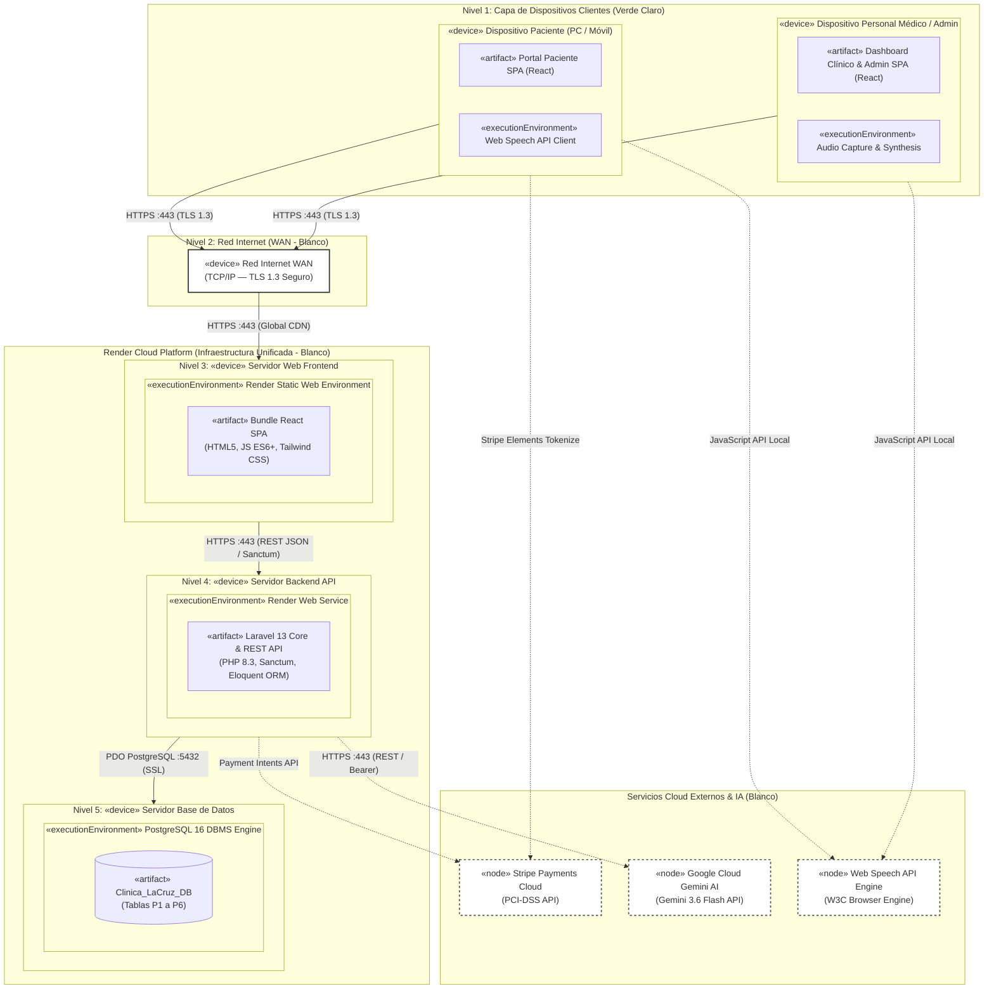

# Diagrama de Despliegue de Infraestructura Cloud
**Proyecto:** Clínica Vida Salud (Centro Médico La Cruz)  
**Metodología:** PUDS / RUP (Fase de Diseño e Implementación / Vista de Despliegue)  
**Estándar:** UML 2.5+ (Deployment Diagram)  
**Entorno de Modelado:** Enterprise Architect (Script JScript WSH)  
**Infraestructura Producción:** **Render Cloud Platform** (Frontend Static Site, Backend Web Service y Managed PostgreSQL 16)  
**Servicios Externos:** Google Gemini AI 3.6, Stripe Payments API, Web Speech API (W3C)

---

## 1. 🎨 Estilo Visual y Convención de Colores

* **Dispositivos Clientes (`«device»`):** Resaltados en **verde claro** (`#D5E8D4`, BGR `13954453`), distinguiendo los puntos de interacción de los pacientes y el personal clínico.
* **Nodos de Red y Servidores Cloud (`«node»` / `«device»`):** Resaltados en **blanco puro** (`#FFFFFF`, BGR `16777215`) para diferenciar los contenedores de infraestructura del proveedor Render y la red WAN.
* **Vías de Comunicación (`CommunicationPath`):**
  - Conexiones direccionales con **flecha de navegación** (`Source -> Destination`).
  - Nombre explícito del protocolo y puerto (`HTTPS :443 (TLS 1.3)`, `PDO PostgreSQL :5432 (SSL)`, etc.).
  - **Sin el estereotipo textual `«communication»`**, manteniendo el diagrama limpio y legible.

---

## 2. 🌐 Descripción de la Infraestructura Cloud (Para Documentación del Proyecto)

### Despliegue e Infraestructura Cloud

* **Render (Frontend — Static Site):**  
  Plataforma moderna en la nube utilizada para el alojamiento y distribución global del frontend en React. Dispone de integración continua automatizada (CI/CD) vinculada al repositorio de GitHub, compilando automáticamente cada nueva versión y distribuyendo los activos estáticos a través de una red global de entrega de contenidos (Edge CDN) con certificados SSL/TLS aprovisionados y renovados automáticamente, garantizando alta disponibilidad y tiempos de carga mínimos para pacientes y personal clínico.

* **Render (Backend — Web Service):**  
  Plataforma de infraestructura como servicio (PaaS) empleada para el despliegue del backend en Laravel 13 (PHP 8.3). Ejecuta el aplicativo dentro de contenedores administrados y aislados con soporte nativo para HTTPS, reinicios automáticos sin tiempo de inactividad (*zero-downtime deploys*), gestión protegida de variables de entorno, balanceo de carga y soporte integral de dependencias PHP/Composer.

* **Render (Base de Datos — Managed PostgreSQL):**  
  Servicio gestionado de base de datos relacional PostgreSQL 16 alojado dentro del mismo centro de datos que el backend de Render para minimizar la latencia de red. Proporciona persistencia en almacenamiento SSD de alta velocidad, copias de seguridad automáticas diarias, cifrado forzado en tránsito mediante SSL/TLS (`PDO PostgreSQL :5432`) y soporte transaccional robusto para garantizar la prevención de colisiones en la reserva de citas (`DB::transaction`).

* **Servicios Cloud Externos e Inteligencia Artificial:**
  - **Stripe API (Pasarela de Pagos):** Procesamiento de cobros electrónicos para reservas y consultas médicas mediante tarjeta de débito/crédito, certificado bajo la normativa de seguridad bancaria PCI-DSS Nivel 1.
  - **Google Gemini API 3.6 (IA Asistencial):** Modelo fundacional en la nube para el chatbot de orientación preliminar a pacientes y para la interpretación en lenguaje natural de comandos de voz hacia filtros estructurados JSON.
  - **Web Speech API (Estándar W3C en Navegador):** Interfaz nativa del navegador para captura y síntesis de voz, utilizada en el dictado de reportes clínicos y emisión de consultas por parte de los operadores.

---

## 3. 🏛️ Previa del Diagrama de Despliegue en Mermaid

---

## 4. 📄 Archivo de Script para Enterprise Architect

El script nativo en JScript para Enterprise Architect se encuentra disponible en:
* [**`docs/UML/diagrama_despliegue.js`**](file:///c:/Users/PERSONAL/clinica-SI1/docs/UML/diagrama_despliegue.js)

### Instrucciones para ejecutar en Enterprise Architect:
1. Abre tu proyecto en **Enterprise Architect** (v15 o v16+).
2. Abre la ventana de scripting: **Specialize** > **Tools** > **Scripting** (o `Ctrl + Shift + F8`).
3. En el grupo de scripts **JScript**, abre o crea un script, pega el código de [`diagrama_despliegue.js`](file:///c:/Users/PERSONAL/clinica-SI1/docs/UML/diagrama_despliegue.js).
4. Haz clic en **Run Script** (`F5`).
5. El diagrama se generará automáticamente con:
   - Dispositivos de clientes en verde claro (`#D5E8D4`).
   - Servidores y nodos en blanco (`#FFFFFF`).
   - Conectores direccionales con etiqueta de protocolo sin el estereotipo `«communication»`.
